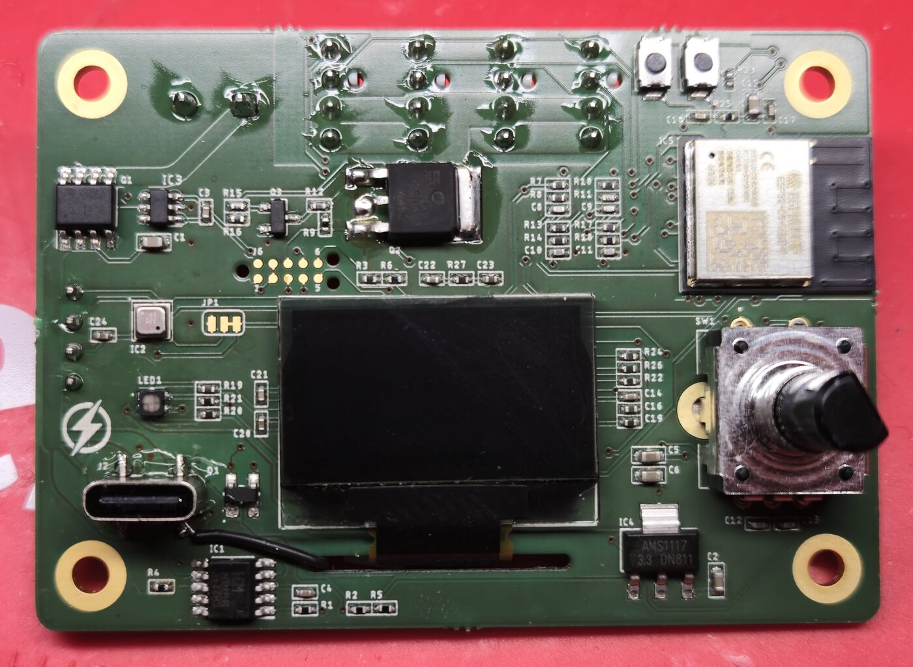
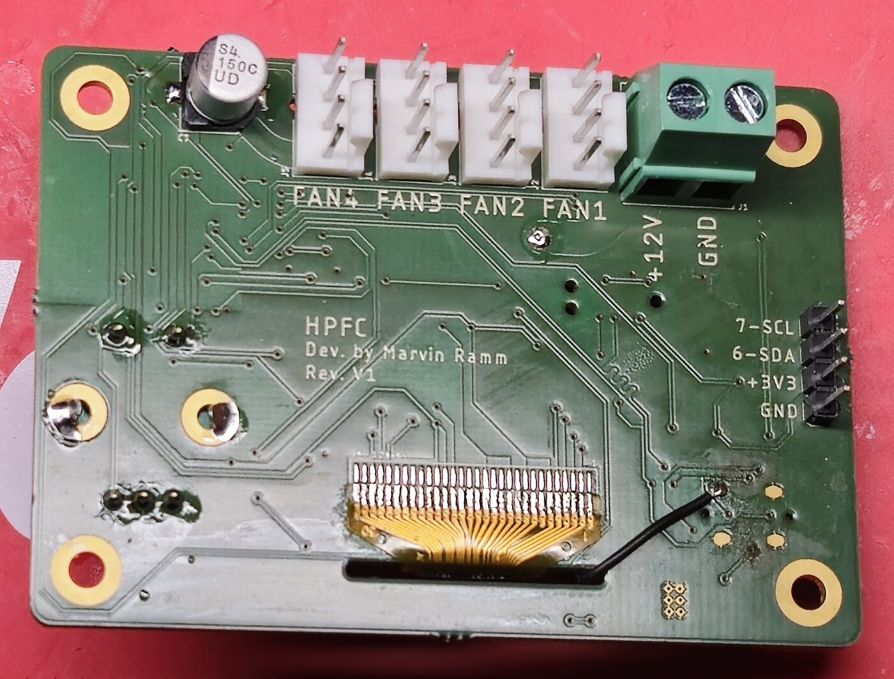
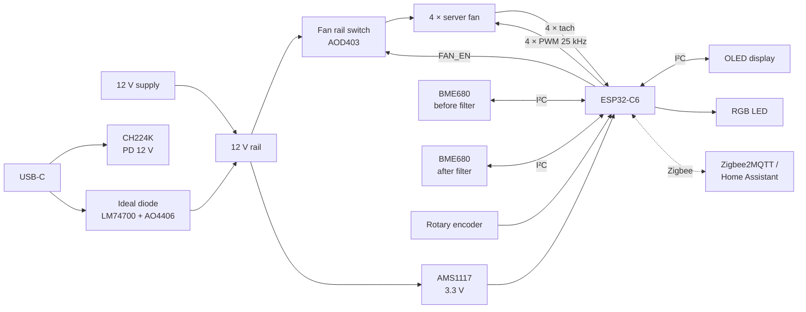
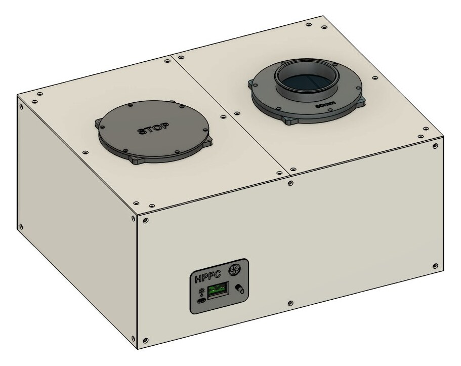
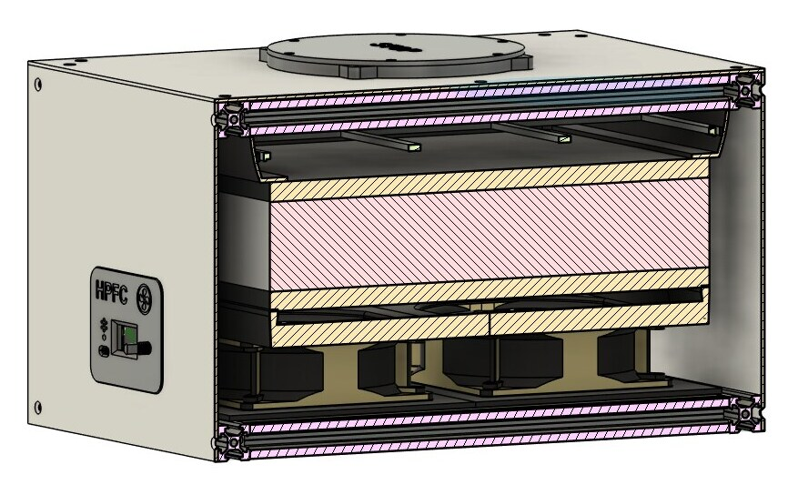
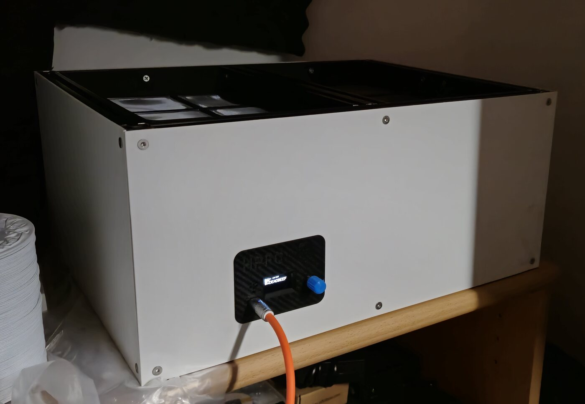
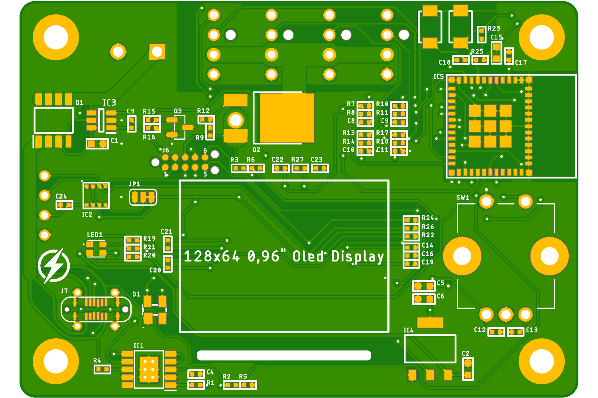
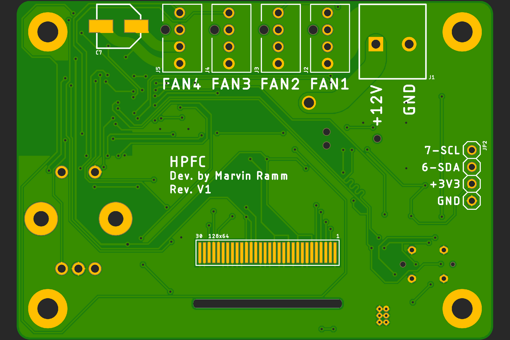

# HPFC – High Power Fan Controller

**Controller for four 12 V server fans with up to 100 W, built into a DIY air filter. It measures the pressure drop across the filter with two BME680 sensors, has its own OLED display and rotary encoder, and joins Zigbee networks, e.g. Home Assistant through Zigbee2MQTT.**

  
  

I built the HPFC in 2025 for my own air filter: four Arctic server fans at 8000 RPM move the air through a filter in a closed box. A server fan is loud and needs a lot of power, so it needs a controller that runs it as slowly as possible and tells me when the filter is clogged. The HPFC does that: it compares the air pressure before and after the filter, shows the filter load on the display and on the RGB LED, and reports it to Home Assistant.

## Features

- **4 fan channels** for standard 4-pin PWM fans: 25 kHz PWM, tach input on every channel, 12 V rail switched off completely when the fans stop
- **Up to about 100 W** fan power on one 12 V rail (tested with four Arctic server fans, 8000 RPM)
- **Power supply:**
  - external **12 V** supply on a screw terminal, full fan power
  - or **USB-C Power Delivery**: the CH224K requests 12 V from a PD charger, fan power limited by the firmware
  - LM74700 ideal diode on the USB-C input, so both sources can be connected at the same time without back-feeding the USB port
  - on plain 5 V USB the board runs (display, Zigbee, flashing), the fans stay off
- **Filter monitoring:** two BME680 sensors, one on each side of the filter. The pressure difference is shown as filter load in percent; the LED turns green, yellow or red.
- **Climate data:** temperature and humidity of the air
- **Zigbee 3.0 router** with the ESP32-C6: fan speed 0–100 %, temperature, humidity and filter load as Zigbee endpoints, external converter for [Zigbee2MQTT](firmware/zigbee2mqtt/HPFC.js)
- **Local UI:** 0.96" OLED, rotary encoder with push button, display turns off after 200 s without input
- **ESP32-C6-MINI-1** with native USB on the USB-C port, Tag-Connect TC2050 for programming

## How it works

## The air filter

The HPFC sits behind the front panel of the filter box. The four fans are mounted under the filter layer and move the air through it. The second BME680 is connected to the I²C header with a short cable and sits on the other side of the filter, so the controller can measure the pressure difference across it.

  
  

  

## Display and status LED

| Page | Content |
|---|---|
| Fan speed | Fan speed in %, power source (`USB 5V`, `USB PD 12V`, `Internal Supply`), Zigbee status |
| Filter pressure | Filter load in % (pressure difference relative to `MAXPADELTA`, default 350 Pa) |

Press the encoder to switch pages. The RGB LED shows the filter load: green below 45 %, yellow from 45 %, red from 70 % – time to change the filter.

## Firmware

HPFOS V0.1.4, Arduino with ESP32 core 3.3. Build instructions, settings, the Zigbee endpoints and the Zigbee2MQTT setup are in [`firmware/README.md`](firmware/README.md).

## Hardware

| | |
|---|---|
| PCB | 2 layers, 71.5 × 50.85 mm, 1.6 mm |
| Schematic | [`hardware/hpfc-v1/HPFC-V1_schematic.pdf`](hardware/hpfc-v1/HPFC-V1_schematic.pdf) |
| BOM | [`hardware/hpfc-v1/HPFC-V1_BOM.csv`](hardware/hpfc-v1/HPFC-V1_BOM.csv), [interactive BOM](hardware/hpfc-v1/HPFC-V1_ibom.html) |
| Design files | EAGLE / Fusion Electronics in [`hardware/hpfc-v1/source`](hardware/hpfc-v1/source) |
| Fabrication data | ODB++ and Gerber in the [release](https://github.com/marvinramm/HPFC-High-Power-Fan-Controller/releases) |

Block description and pin assignment: [`hardware/README.md`](hardware/README.md).

  
  

## License

© 2025 Marvin Ramm. Free for **non-commercial** use with attribution:

- Firmware (`firmware/`): [PolyForm Noncommercial 1.0.0](LICENSE)
- Hardware and documentation: [CC BY-NC 4.0](hardware/LICENSE)

Credit "HPFC by Marvin Ramm" with a link to this repository. **Selling boards, kits or products based on the HPFC needs my agreement**, e.g. with a share of the profit – contact marvin@ramm-eng.de. Details are in [LICENSING.md](LICENSING.md).
